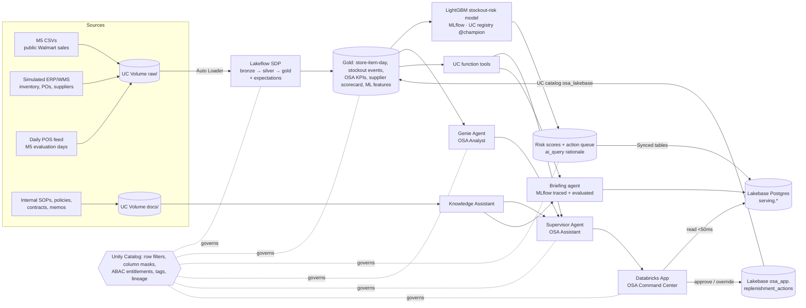

# OSA Command Center — predicting and preventing grocery stockouts on Databricks

**Industry:** Retail / CPG — mass-market grocery & general merchandise.
**Customer problem:** a 10-store regional chain (CA / TX / WI) loses revenue every day to empty shelves. Replenishment
teams find out *after* the shelf is empty, because the signals — an overdue supplier PO, stock cover running down,
"phantom" inventory that the system thinks exists — sit in different systems and nobody is told what to do.

**Outcome delivered:** every night, the platform predicts which store-items will go out of stock in the next 3 days,
sizes the order per the replenishment SOP, explains it in plain English, puts it in an action queue that store
managers approve in an app, writes agentic briefings for leaders, and answers questions over company data and policy
in natural language. Store decisions flow back into the lakehouse and into the next night's scoring.

> **Data:** demand is the public **M5 Forecasting** dataset (Walmart, 3,049 items × 10 stores, 2011-01-29 → 2016-06-19;
> 59 M store-item-days of real unit sales, prices, events, SNAP days). Inventory, POs, suppliers and internal documents
> are **synthetic**, simulated *from* the real M5 sales so they stay consistent (see `src/setup/02_generate_ops_data.py`),
> and are tagged `osa_data_origin = synthetic` in Unity Catalog. No customer data is used.

## End-to-end journey (one integrated flow, not silos)



| Stage | What runs | Where |
|---|---|---|
| **Lakeflow** — ingest | Auto Loader streaming tables over the landing volume (wide M5 CSV unpivoted to 59 M rows, daily POS / inventory / PO-event folders), append flows, data-quality expectations (drop / warn / fail), materialized-view gold layer | `src/pipeline/transformations/*.py`, `resources/osa.pipeline.yml` |
| **Unity Catalog** — govern | Entitlement-driven row filter (region) + column masks (supplier commercial terms, item cost, e-mails) attached in the pipeline; governed tags (`layer`, `domain`, `class.*`), column docs, grants, lineage; persona proof with a real service principal | `src/governance/`, `scripts/governance_persona_check.py` |
| **ML / GenAI** — intelligence | LightGBM 3-day stockout-risk classifier with SHAP drivers, MLflow tracking, UC model registry alias `@champion`; SOP-based order sizing; `ai_query` rationale per alert | `src/ml/` |
| **Lakebase** — operational serving | Synced tables (Delta → Postgres) for the action queue, risk lookups and briefings; app-owned transactional table for decisions; Lakebase registered as UC catalog `osa_lakebase` so the nightly job reads decisions back | `scripts/setup_lakebase.sh`, `src/lakebase/`, `app/app.py` |
| **Genie Agent** — natural language | *OSA Analyst* space over 9 governed tables with instructions, joins, example SQL and benchmark questions; scored against reference SQL | `scripts/genie_space.py`, `scripts/genie_benchmark.py` |
| **Agents** | Supervisor Agent (*OSA Assistant*) routing to Genie + Knowledge Assistant (internal docs) + UC function tools; tool-calling briefing agent (executive + 3 regional reports), MLflow-traced and evaluated with `mlflow.genai.evaluate` | `scripts/setup_*`, `src/agents/` |
| **Databricks App** — business surface | FastAPI app: KPI tiles + trend, Lakebase action queue with approve/override/reject, item lookup, nightly briefings, Q&A chat (Assistant or Genie with SQL shown), governance view | `app/`, `resources/osa.app.yml` |

Orchestration: `osa_01_nightly_osa_intelligence` (Lakeflow Job, 10 tasks) and `osa_02_release_next_day_feed`
(drops the next business day's files, then runs the nightly job) — all deployed with one Declarative Automation Bundle
(`databricks.yml`).

## Execution evidence (text, committed)

See **[`evidence/README.md`](evidence/README.md)** — notebook cells with their real outputs for every job task,
pipeline event-log metrics and data-quality results, model metrics vs. baseline, governance persona proof, Genie
benchmark results, Supervisor-Agent Q&A transcripts, app API responses, Lakebase round-trip, and agent-written
briefings with their evaluation scores.

## Results at a glance

| | Result | Evidence |
|---|---|---|
| Baseline (52 wks, 10 stores) | OSA 90.4 %, $2.82 M lost to stockouts (5.9 % of sales) | `evidence/runs/*/lakeflow_pipeline.md`, deck appendix |
| Model vs. today's rule (test 1–19 May 2016) | ROC AUC 0.953 vs 0.768 · PR AUC 0.824 vs 0.349 · precision of top-500 alerts/day 96 % vs 48 % · lost revenue covered 33.8 % vs 14.2 % | `evidence/runs/00c_*/train_model.md` |
| Forward check on unseen real sales | Critical items sold at 26 % of normal demand vs 95 % for OK items | `evidence/ml/forward_check.md` |
| Governance | South persona sees only South rows; supplier terms, cost and e-mails masked; bronze denied | `evidence/governance/persona_check.md` |
| Genie Agent | benchmark answers vs reference SQL | `evidence/genie/benchmark.md` |
| Knowledge Assistant | 10/10 policy questions answered with the expected fact | `evidence/agents/knowledge_assistant_eval.md` |
| Briefing agent | 4 briefings/night; 7 scorers (incl. numeric grounding) at 100 % | `evidence/runs/00d_*/intelligence_briefings.md` |
| App + Lakebase | action-queue reads ~300 ms end-to-end, typeahead < 20 ms in Postgres; decisions round-trip Lakebase → UC → Delta | `evidence/app/api_responses.md`, `evidence/lakebase/roundtrip.md` |

**Honest caveat.** Sales and stockout outcomes are real (M5), but inventory, POs and suppliers are simulated, and the
simulator places a late PO or phantom stock in front of each real stockout so it is explainable. Supply-side features
are therefore cleaner than a real ERP's: treat model precision as an upper bound. The business case halves the effect
(50 % prevention) and the chain view uses the industry 4 % lost-sales rate.

**Known platform limitations hit during the build** (and how they were handled):
* The workspace only allows default-storage catalogs to be created in the UI → the project uses a dedicated schema.
* Account tag-policy limit reached → governed keys `layer` / `domain` / `class.*` plus free keys `osa_data_origin`.
* Workspace-local groups cannot be used in UC grants → entitlement table (ABAC) + grants to real principals.
* Attaching UC functions as Supervisor-Agent tools failed with "Failed to register UC function tool" → the Supervisor
  routes to Genie + Knowledge Assistant; the same governed UC functions are the briefing agent's tools.

## Reproduce

```bash
databricks bundle deploy -p <profile>                             # schema, volumes, pipeline, jobs, app
databricks bundle run osa_setup -p <profile>                      # land M5, simulate ERP, publish docs
databricks bundle run osa_daily -p <profile>                      # full nightly chain (first run trains the model)
./scripts/setup_knowledge_assistant.sh                            # Agent Bricks Knowledge Assistant over docs/
python3 scripts/genie_space.py create                             # Genie Agent
GENIE_SPACE_ID=... KA_ID=... ./scripts/setup_supervisor_agent.sh   # Supervisor Agent
WITH_REPORTS=1 ./scripts/setup_lakebase.sh                        # UC catalog over Lakebase + synced tables
databricks bundle deploy -p <profile> && databricks apps deploy osa-command-center -p <profile>
databricks bundle run osa_release_feed -p <profile>               # next business day arrives -> nightly run
```

Workspace-specific values (catalog, warehouse, Lakebase project, endpoints) are bundle variables in `databricks.yml`.
